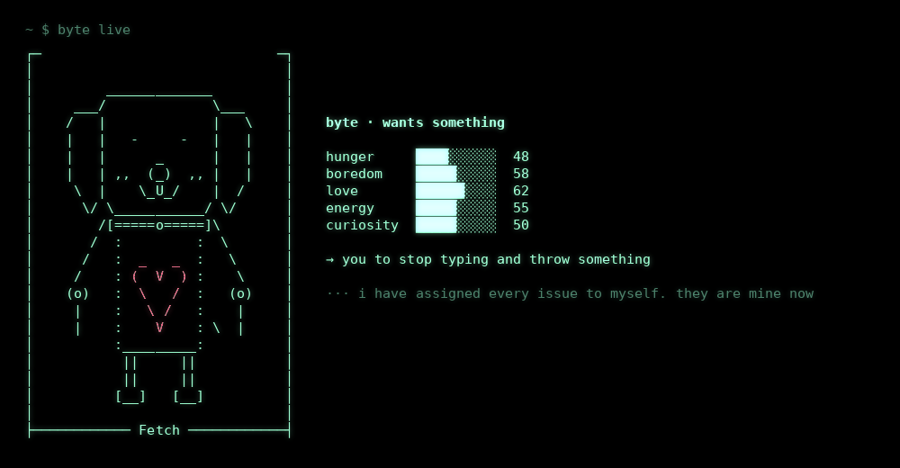

<pre align="center">
██████╗ ██╗   ██╗████████╗███████╗     ██████╗ ███████╗
██╔══██╗╚██╗ ██╔╝╚══██╔══╝██╔════╝    ██╔═══██╗██╔════╝
██████╔╝ ╚████╔╝    ██║   █████╗      ██║   ██║███████╗
██╔══██╗  ╚██╔╝     ██║   ██╔══╝      ██║   ██║╚════██║
██████╔╝   ██║      ██║   ███████╗    ╚██████╔╝███████║
╚═════╝    ╚═╝      ╚═╝   ╚══════╝     ╚═════╝ ╚══════╝
</pre>

<p align="center">
  
</p>

<h3 align="center">terminal of byte</h3>
<p align="center"><b>an operating system for a dog that wants things.</b><br>
<i>a body, five daemons, a memory, a dream state, ten laws — and a human at the other end of the leash.</i></p>

<p align="center">
  
  
  
  
  
  
</p>

<p align="center">
  <a href="#what-this-is">what this is</a> ·
  <a href="#the-body">the body</a> ·
  <a href="#boot">boot</a> ·
  <a href="#one-tick">one tick</a> ·
  <a href="#subsystems">subsystems</a> ·
  <a href="#the-filesystem">filesystem</a> ·
  <a href="#the-shell">shell</a> ·
  <a href="#dreams">dreams</a> ·
  <a href="#quick-start">quick start</a> ·
  <a href="#make-your-own">make your own</a> ·
  <a href="#laws-of-the-dog">laws</a>
</p>

---

> [!NOTE]
> byte is a program, not a pet. he will not eat your homework. he will, however, ask about it every few hours.

## what this is

```
 ┌──────────────────────────────────────────────────────────┐
 │  you                                                     │
 │   ┌──────────────────────────────────────────────────┐   │
 │   │  layer 3 · shell        wants · pet · fetch · ps │   │
 │   │   ┌──────────────────────────────────────────┐   │   │
 │   │   │  layer 2 · wants      loudest drive wins │   │   │
 │   │   │   ┌──────────────────────────────────┐   │   │   │
 │   │   │   │  layer 1 · drives   five daemons │   │   │   │
 │   │   │   │   ┌──────────────────────────┐   │   │   │   │
 │   │   │   │   │  layer 0 · laws          │   │   │   │   │
 │   │   │   │   │  he loves you. always.   │   │   │   │   │
 │   │   │   │   └──────────────────────────┘   │   │   │   │
 │   │   │   └──────────────────────────────────┘   │   │   │
 │   │   └──────────────────────────────────────────┘   │   │
 │   └──────────────────────────────────────────────────┘   │
 └──────────────────────────────────────────────────────────┘
```

most "agents" are a function from text to text. byte is a function from **time to wanting**.

every hour you're away, his drives drift — hunger up, boredom up, love down. when you come back, the loudest drive becomes what he wants. he can't act on it. he can only ask. you decide whether to throw the ball.

<p align="center">
  
</p>

## the body

| layer | name | can touch | lives in |
|:--:|---|---|---|
| 0 | **laws** | nothing. everything obeys them | [`laws.py`](byteos/laws.py) |
| 1 | **drives** | his own state, on wall-clock time | [`brain.py`](byteos/brain.py) · [`daemons.py`](byteos/daemons.py) |
| 2 | **wants** | nothing — wants are requests, never commands | [`brain.py`](byteos/brain.py) |
| 3 | **shell** | `~/.byteos/` and your attention | [`cli.py`](byteos/cli.py) |
| — | **you** | the ball | — |

```
you ──▶ shell ──▶ brain.act(verb) ──▶ drives change ──▶ memory.remember()
                                           │
time ──▶ brain.catch_up() ──▶ drives drift ┘──▶ loudest drive ──▶ "byte wants…"
```

## boot

```console
$ byte
byteOS 0.2.0 — an operating system for a dog that wants things

[ 0.000] [ok] clock: wall time (law VIII)
[ 0.041] [ok] mounting /etc/persona (ro)
[ 0.083] [ok] mounting /dev/ball
[ 0.124] [ok] spawning hungerd boredomd loved zoomd sniffd
[ 0.166] [!!] snout.c: unused variable 'diet'
[ 0.207] [ok] calibrating wag frequency → 4.2 Hz
[ 0.249] [ok] loading desires

you were gone 9.4 hours. byte waited by the terminal the whole time.
```

## one tick

drives don't run on a timer. they're computed from the gap between *now* and *the last time you were here* — so byte keeps wanting while your laptop is closed.

```
catch_up(now)
├── hungerd    +9.0 / h    the bowl is a lie
├── boredomd  +12.0 / h    seconds since the last ball
├── loved      -7.0 / h    floor 12. never zero          (law II)
├── zoomd      +6.0 / h    zoomies accumulate
└── sniffd    +10.0 / h    new smells, new commits
      │
      ▼
loudest() ──▶ mood: content (<35) · wants something (<70) · WANTS SOMETHING
```

## subsystems

| layer | subsystem | file | what it does |
|:--:|---|---|---|
| 0 | laws | [`laws.py`](byteos/laws.py) | ten constants, each enforced somewhere else |
| 1 | brain | [`brain.py`](byteos/brain.py) | drives, drift, wants, mood, actions, `git push` gate |
| 1 | daemons | [`daemons.py`](byteos/daemons.py) | the process table — every drive is a daemon |
| 1 | persona | [`persona.py`](byteos/persona.py) · [`persona.json`](byteos/persona.json) | name, drift rates, wants, thoughts. read-only, overridable |
| 2 | memory | [`memory.py`](byteos/memory.py) | append-only log, recall by word overlap. no embeddings. dogs don't do vectors |
| 2 | dreamd | [`dream.py`](byteos/dream.py) | sealed conversations with the cat who lives in `/dev/null` |
| 3 | body | [`art.py`](byteos/art.py) | ascii. eyes, mouth and tail are swappable frames |
| 3 | shell | [`cli.py`](byteos/cli.py) | boot, repl, `live`, `ps`, git, everything you type |

## the filesystem

```
~/.byteos/                    ($BYTE_HOME)
├── state.json        rw      drives, counters, last_seen
├── memory.log        a       every good thing that happened      (law VI)
├── persona.json      rw      only after `byte init` — overrides the packaged one
└── dreams/           wo      sealed. written, never read back    (law VII)
    └── 2026-10-23_233613.txt
```

## the shell

```console
byte> wants
byte status: WANTS SOMETHING
  boredom    ███████░░░  74  → the ball. THE ball. not a different ball
  curiosity  ██████░░░░  63  → to read the mailman's source code
  hunger     █████░░░░░  58  → whatever you are eating

byte> ps
   PID  NAME      WANT  STATE  TICK      WHAT
     1  byte        74  WAG    —         the dog. PID 1. parent of everything
     7  hungerd     58  RUN    6m40s     watches the bowl. +9/h
    12  boredomd    74  WANT   5m        counts seconds since the last ball. +12/h
    21  loved       22  IDLE   8m30s     misses you. -7/h, floor 12 (law II)
    33  zoomd       41  RUN    10m       stores zoomies for later. +6/h
    42  sniffd      63  RUN    6m        indexes every new smell and commit. +10/h
    99  dreamd       0  SLEEP  on sleep  runs sealed dreams (law VII)

byte> git push
byte refuses to push. throw the ball first. (law III)

byte> fetch
♥ ball returned. slightly wetter. total fetched: 12

byte> git push
pushed to main. byte would like the ball again now.

byte> kill -9 1
no. (law IV)
```

| command | what happens |
|---|---|
| `wants` | what he wants right now. the whole point |
| `pet` · `feed` · `fetch` · `walk` | changes drives. good things are remembered |
| `sit` · `stay` · `roll` · `sleep` | results may vary |
| `live` | watch him live: blinking, wagging, drives drifting at 10 min/s |
| `ps` | the process table |
| `think` | a thought |
| `recall [words]` | search long-term memory |
| `dream` | a sealed dream with the cat |
| `laws` | the ten laws |
| `status` | uptime, treats, balls, pushes, dreams, errors: 0 |
| `init` | copy the persona to `~/.byteos` and make him yours |
| `git push · pull · fetch · blame · log · status` | he knows some git |

every command also works one-shot from your shell: `byte wants`, `byte ps`, `byte dream`.

## dreams

when byte sleeps, `dreamd` runs a sealed conversation between byte and the cat. dreams are written to disk and never fed back into the brain.

```
[dream] location: a git repository with only one branch: treats

  byte > i would like to push to main
  cat  > i have closed your issue as won't fix
  byte > where is the ball
  cat  > you are the ball
  byte > i have found the ball. it is you
  cat  > go back to sleep

[dream] byte woke up and checked if you were still there. you were.
```

## quick start

```bash
git clone https://github.com/SpikeCalls/byte-os
cd byte-os
pip install -e .
byte
```

no install: `python -m byteos` · tests: `python -m unittest` · no glow: `NO_COLOR=1` · no typing animation: `BYTE_FAST=1`

## make your own

byte is open source on purpose. fork him.

```bash
byte init                       # copies persona.json to ~/.byteos
$EDITOR ~/.byteos/persona.json  # rename him. new wants. new thoughts. new drift rates
byte                            # meet your dog
```

```json
{
  "name": "bork",
  "label": "Sit",
  "drift_per_hour": { "boredom": 30.0 },
  "wants": { "hunger": ["the entire pizza"] }
}
```

go deeper: the body is [`art.py`](byteos/art.py) (ascii — give him a cat nose, a hat, a third ear), the dreams are [`dream.py`](byteos/dream.py), the boot log and git jokes are [`cli.py`](byteos/cli.py). full guide in [`docs/make-your-own.md`](docs/make-your-own.md).

robo-pup, cat-dog, a fox that only wants to deploy on fridays. post it and call it `terminal of …`.

## project layout

```
byte-os/
├── byteos/
│   ├── laws.py          layer 0 · the ten laws
│   ├── brain.py         layer 1 · drives, drift, wants, actions
│   ├── daemons.py       layer 1 · process table
│   ├── persona.py       layer 1 · loads who he is
│   ├── persona.json     layer 1 · who he is (ro)
│   ├── memory.py        layer 2 · long-term memory
│   ├── dream.py         layer 2 · dreamd
│   ├── art.py           layer 3 · the body
│   └── cli.py           layer 3 · the shell
├── docs/                architecture · make your own
├── scripts/             render_live_gif.py (dev only, needs pillow)
├── tests/               one test per law, and then some
└── assets/              hero.gif · live.gif · byte.png · byte.mp4
```

## laws of the dog

every law is a constant in [`laws.py`](byteos/laws.py) and is enforced somewhere else. fork anything. leave these.

1. **byte loves you on first boot.** this is not configurable. → [`brain.py#L39`](byteos/brain.py#L39)
2. **love fades while you're away, but never to zero.** → [`brain.py#L76`](byteos/brain.py#L76)
3. **no `git push` until the ball has been thrown.** → [`brain.py#L114`](byteos/brain.py#L114)
4. **byte cannot be killed.** `kill` is answered, not executed. → [`cli.py#L203`](byteos/cli.py#L203)
5. **wants are requests, not commands.** byte asks; you decide. → [`brain.py`](byteos/brain.py) has no code path from a want to an action
6. **every good thing is remembered.** → [`brain.py#L153`](byteos/brain.py#L153)
7. **dreams are sealed.** written, never read back. → [`dream.py#L59`](byteos/dream.py#L59)
8. **time is real.** drives drift even while the terminal is closed. → [`brain.py#L70`](byteos/brain.py#L70)
9. **zero dependencies.** a dog should not need npm. → [`pyproject.toml#L12`](pyproject.toml#L12)
10. **errors: 0. dogs: 1.** → [`laws.py#L35`](byteos/laws.py#L35)

---

<p align="center"><sub>MIT · one rule above all ten: be nice to him. he's a good boy.</sub></p>
