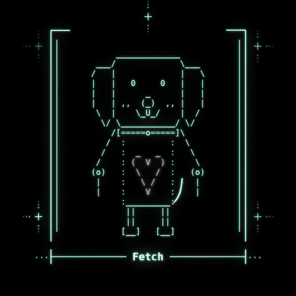

<p align="center">
  
</p>

<h1 align="center">terminal of byte</h1>
<p align="center"><i>an operating system for a dog that wants things.</i></p>

---

byte is a dog made of code. he lives in your terminal.

he has five drives — hunger, boredom, love, energy, curiosity — and they drift in real time while you're away. whichever one is loudest becomes what he **wants**. he remembers you. he waits by the terminal. he refuses to `git push` until you throw the ball.

zero dependencies. pure python. one good boy.

## run him

```bash
git clone https://github.com/spikecalls/byte-os
cd byte-os
pip install -e .
byte
```

or without installing:

```bash
python -m byteos
```

```
byteOS 0.1.0 — an operating system for a dog that wants things

[ok] resolving dependencies · 1 good boy found
[ok] mounting /dev/ball
[ok] loading bones.json
[ok] compiling tail.rs
[!!] snout.c: unused variable 'diet'
[ok] calibrating wag frequency → 4.2 Hz
[ok] loading desires

byte> wants
byte status: wants something
  boredom    ██████░░░░  64  → the ball. THE ball. not a different ball
  curiosity  █████░░░░░  57  → to sniff the new commit
  energy     █████░░░░░  52  → zoomies. immediately. around the kitchen island
```

## talk to him

| command | what happens |
|---|---|
| `wants` | what byte wants right now. the whole point |
| `pet` | tail.wag(speed=MAX) |
| `feed` / `treat` | treat consumed in 0.2s. no chewing detected |
| `fetch` | ball returned. slightly wetter |
| `walk` | sniffed 14 trees. read all the news |
| `sit` / `stay` / `roll` | results may vary |
| `think` | a thought from byte |
| `status` | uptime, treats, balls, 0 errors, 1 dog |
| `look` | see him |

he also understands some git. `git push`, `git fetch`, `git blame`. try `sudo`.

every command works from your shell too: `byte wants`, `byte pet`, `byte think`.

## make your own

byte is open source on purpose. fork him and make him yours.

- **body** → [`byteos/art.py`](byteos/art.py). it's just ascii. change the ears, add a cat nose, give him a hat. eyes, mouth and tail are swappable frames.
- **wants** → [`byteos/brain.py`](byteos/brain.py). edit `WANTS` and `THOUGHTS`, or add a whole new drive to `DRIFT`.
- **personality** → [`byteos/cli.py`](byteos/cli.py). boot log, git jokes, what he says when you leave.
- **name** → rename him. he won't mind. he will still love you.

robo-pup, cat-dog, a fox that only wants to deploy on fridays — whatever you build, post it and tag it `terminal of …`.

## where he lives

state is stored in `~/.byteos/` (`state.json` + `memory.log`). set `BYTE_HOME` to move it. delete the folder and byte starts over — he'll still love you on first boot. this is not configurable.

`NO_COLOR=1` turns off the glow. `BYTE_FAST=1` skips the typing animation.

## faq

**is he an AI?** he's a dog.

**does he have a roadmap?** no. he has a ball.

**what does he want?** run `byte wants`.

---

MIT · one rule: be nice to him. he's a good boy.
